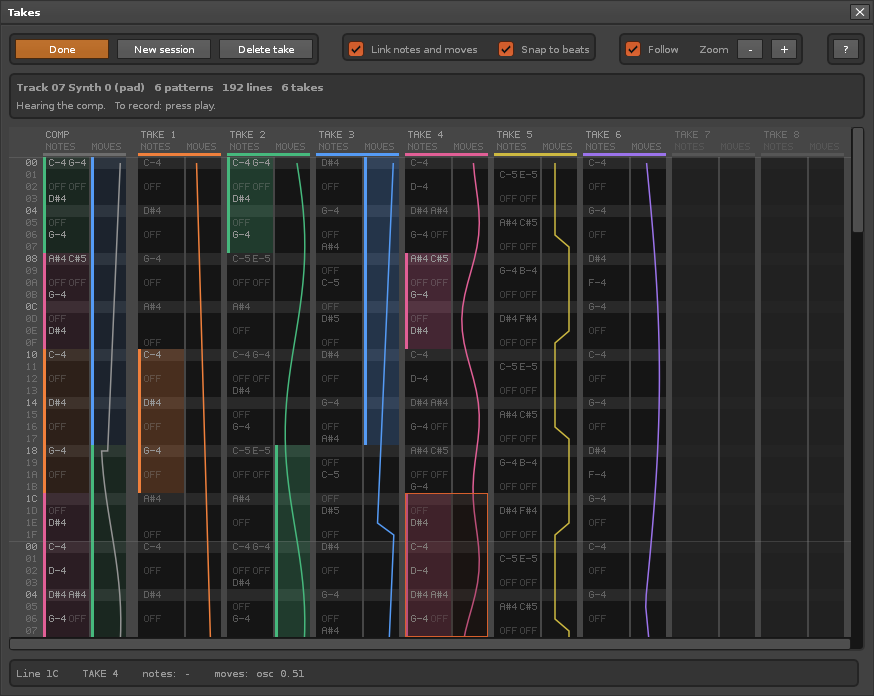

# Takes

Comping for [Renoise](https://www.renoise.com). Record several passes over a loop, keep every
pass as a take, then build the best version from the takes.



Renoise overwrites what you played when a loop comes around. Takes keeps each pass instead.
The takes stand side by side as lanes, with time running downward like the pattern editor.
You listen to them, swipe over the parts you like, and the result goes back into the pattern.

- **Notes and parameter moves.** A take holds the note columns, the effect columns and the
  automation of the armed track. You can use the notes of one take and the filter sweep of another.
- **One pattern or several.** Loop a single pattern, or a range of patterns in the sequencer.
- **Nothing is lost.** Notes that were already in the track become take 1. If you edit the
  track by hand, that edit becomes a take too.
- **Saved in the song.** The takes travel with the song file. Open the song next week and keep comping.

This is an early version. It works, and it has rough edges: read "Good to know" in the user guide.

## Install

Download `com.dac514.Takes.xrnx` from the [releases](https://github.com/dac514/takes/releases)
and drag it onto the Renoise window. Renoise 3.5 is needed.

## Use

The user guide is [com.dac514.Takes.xrnx/README.md](com.dac514.Takes.xrnx/README.md).
Renoise shows the same text in its tool browser. In short:

1. Loop a pattern, or a range of patterns.
2. Put the cursor in a track, open **Tools > Takes...** and press **Arm**.
3. Play with edit mode on. Each pass of the loop becomes a take.
4. Swipe down a take lane to use those lines. Click a take title to hear that take alone.
5. Press **Done**. The pattern keeps the result.

How it works inside, what was measured, and what is still open: [docs/comping.md](docs/comping.md).

## Working on the tool

This project was started from the [ReSlop](https://github.com/dac514/reslop) starter kit.
Its tooling formats, checks, installs and reloads the tool while Renoise runs.

Install five things: [just](https://github.com/casey/just) (runs the chores),
[StyLua](https://github.com/JohnnyMorganz/StyLua) (formats Lua),
[lua-language-server](https://github.com/LuaLS/lua-language-server) 3.13.6 or
newer (checks Lua against the Renoise API),
[LuaJIT](https://luajit.org/download.html) (runs the unit tests), and
[Python 3.8 or newer](https://www.python.org/downloads/) (runs the script; no
packages needed).

- macOS: `brew install just stylua lua-language-server luajit`
- Windows: `winget install Casey.Just JohnnyMorganz.StyLua LuaLS.lua-language-server Python.Python.3.13`
  and `scoop install luajit` (or work inside WSL and follow the Linux line)
- Fedora, Ubuntu, WSL: `just` and `luajit` from your package manager, StyLua and
  lua-language-server from their GitHub release archives, unpacked into `~/.local/bin`

Then:

```
just doctor      # lists what is missing and where to get it
just install     # Renoise copies the tool into its Tools folder and loads it
just ping        # ok bridge at 127.0.0.1:18xxx, tool_id=com.dac514.Takes ...
```

No `just` yet? Every recipe is a one-liner around the script, so
`python3 scripts/renoise.py doctor` works just as well.

## Day to day

```
just check          # formatting + type check against the Renoise API
just test           # unit tests under plain LuaJIT, no Renoise needed
just reload         # full reload: zip the tool and have Renoise reinstall it (about a second)
just reload-soft    # quicker: swap in src/ without restarting the tool
just eval 'return renoise.song().transport.bpm'
just eval 'APP.show_dialog()' && just views
just log            # prints and errors from inside the tool
just screenshot     # PNG of the Renoise window and any open dialog, into dist/
just package        # dist/<Id>.xrnx, ready to share (the dev bridge is left out)
```

To publish on renoise.com, upload `dist/<Id>.xrnx` at
[renoise.com/submit/tool](https://www.renoise.com/submit/tool). The tool page
shows your tool's `README.md`, plus a `cover.png` (600x350) and a
`thumbnail.png` (120x45) from the tool folder. `docs/publishing.md` lists the
site's other rules.

## How your assistant sees Renoise

Renoise has no command line, and `print` only reaches its Scripting Terminal.
So the kit ships a small **dev bridge** inside the tool (`dev/bridge.lua`): a
TCP server on `127.0.0.1` with its own port (shown by `just ping`), living in
the tool's own Lua state. It is loaded only while `dev/` exists and never
included by `just package`. The `scripts/renoise.py` CLI talks to the bridge:

- `eval` runs Lua with full access to the tool (`APP`, `renoise`, `io`), captures
  `print` output and returns values as text.
- `views` walks the dialog tree of every registered dialog, so layout and
  state can be verified without a screenshot.
- `reload` re-zips the tool and asks Renoise to reinstall it through the OSC
  server, giving a fresh Lua state in about a second; `reload --soft` swaps in
  `src/` in place instead.
- `log` keeps the last 500 prints and errors; `check` parses the sources with
  Renoise's own LuaJIT.

Renoise's OSC server is used only as a trigger (`/renoise/evaluate` →
`renoise.app():install_tool(zip)`), because it cannot send anything back.
Screenshots are best effort per OS: on X11 every Renoise window is captured,
so an open tool dialog lands in its own PNG; elsewhere you get the whole screen
(`spectacle`, `gnome-screenshot`, `grim`, `screencapture`, PowerShell).

## Upgrading

Projects created from ReSlop don't receive later kit updates automatically.
To bring a project up to date, ask your coding assistant:

> Check the latest upgrade instructions in
> [ReSlop's UPGRADING.md](https://github.com/dac514/reslop/blob/main/UPGRADING.md)
> and apply all updates relevant to this project. Preserve project-specific
> changes and verify the result.

## Platform notes

| | Linux | macOS | Windows (native) | WSL (Linux tools, Windows Renoise) |
|---|---|---|---|---|
| Tools folder | `~/.config/Renoise/V*/Scripts/Tools` | `~/Library/Preferences/Renoise/V*/Scripts/Tools` | `%APPDATA%\Renoise\V*\Scripts\Tools` | found via `powershell.exe $env:APPDATA` |
| `just install` | OSC, else symlink | OSC, else symlink | OSC, else copy (`--link` = junction) | OSC, else copy |
| Bridge bind | 127.0.0.1 | 127.0.0.1 | 127.0.0.1 | `0.0.0.0` + token (NAT mode cannot reach the host's loopback) |
| Screenshot | window or screen | screen | screen | screen via `powershell.exe` |

WSL: `just install` writes `dev/bind` (`0.0.0.0`) and `dev/.token` so the bridge
is reachable from the WSL network namespace and still refuses unauthenticated
peers; the client tries `127.0.0.1`, the default gateway and the resolv.conf
nameserver as hosts. With mirrored networking (`.wslconfig`), pass
`--loopback` to keep everything on localhost. Paths handed to Renoise are
converted with `wslpath -w`.

Environment overrides: `RENOISE_PREFS_DIR`, `RENOISE_VERSION`, `RENOISE_HOST`,
`RENOISE_DEV_PORT`, `RENOISE_OSC_PORT`.

## Credits and license

MIT. Bundles the MIT-licensed
[renoise/definitions](https://github.com/renoise/definitions) and guide pages from
[renoise/xrnx](https://github.com/renoise/xrnx); see the `UPSTREAM.md` files for
the exact commits.
