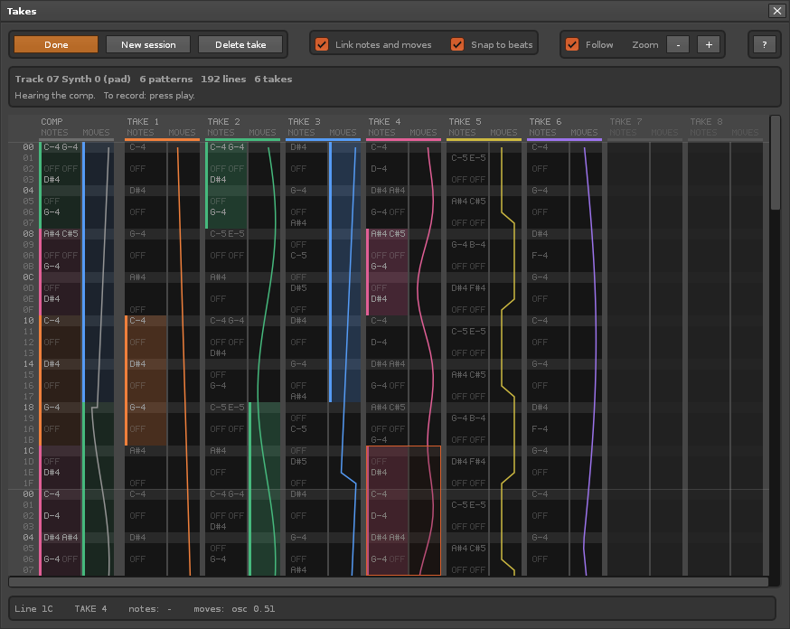

# How Takes works

Takes began as a feasibility study: can Renoise keep each pass of a loop recording as a take,
and let you build the best version from the takes? The answer was yes. This page records how
the tool does it, what the tests measured, and what is still open.

The COMP lane on the left is the result. Its colour bars show which take each part comes from.
In the picture, the notes come from takes 2, 4, 1 and 6, and the parameter moves from takes 3 and 2.
The view keeps one size. Empty lanes stand for the takes to come.

## Try it

1. Run `just install`, or `just reload` when the tool is already installed.
   The user guide for people who only install the tool is the `README.md` inside the bundle.
2. Loop one pattern, or loop a range of patterns in the sequencer.
3. Put the cursor in a track. Open *Tools > Takes...* and press **Arm**.
4. Turn edit mode on and play. Record a few passes. Each pass becomes a take.
   Pattern follow must be on. Arm turns it on, and the status line says what is missing.
   The pattern matrix shows the armed track in orange. While you record, its slots flash red.
5. Turn edit mode off. You hear the newest complete take.
6. Swipe down a take lane to use those lines. Click a take title to hear that take alone.
7. Press **Done**. The pattern keeps the comp. The takes stay in the song file.

The mouse wheel over the lanes zooms in and out. With Shift, or over the line numbers, it scrolls.
The view shows the newest takes. The bar under the lanes moves to earlier takes.
Ctrl + wheel and the Left and Right keys at the edge of the view do the same.

Keyboard, when the view has focus:

| Key | Action |
|---|---|
| Up, Down | Move the selection by one beat. With Ctrl, by one line. |
| Shift + Up, Down | Make the selection longer or shorter. |
| Left, Right | Move to another lane. |
| Enter | Give the selected lines to the take under the cursor. |
| 1 to 8 | Give the selected lines to that lane. |
| S | Hear the take under the cursor. Press again to hear the comp. |
| 0 | Hear the comp. |
| Delete | Remove the selected lines from the comp. |

Other keys go back to Renoise, so Space still starts and stops playback.

## What a take holds

- Note columns: note, instrument, volume, panning, delay and the sample effect.
- Effect columns. Renoise writes parameter moves here in the "Pattern" record mode.
- Automation envelopes. Renoise writes parameter moves here in the "Automation" record mode.

The comp has two layers: notes and moves. With "Link notes and moves" off, a swipe takes only
the strip under the mouse. You can keep the notes of one take and the moves of another.

## How it works

- **The pattern is the recorder and the player.** A tool cannot play notes with exact timing.
  So Renoise records into the pattern track as usual, and the tool moves the result into takes.
  To let you hear a take or the comp, the tool writes it into the pattern track.
- **Capture.** A timer follows the playhead. The loop is cut into parts: one part for each
  pattern, or two halves of a single pattern. A part is read and cleared when the playhead has
  left it. So the part that plays next is always empty, and you only hear what you play.
- **Storage.** Takes are Lua tables. They are saved in the song through `renoise.song().tool_data`.
- **The pattern matrix shows where the takes go.** The slots of the armed track are orange,
  and red while you record. Renoise draws a slot colour only on a slot that holds notes, and the
  capture empties the slots. So the tool also selects and deselects the slots in turn while
  you record, which shows on empty slots too.
- **Hand edits are safe.** Before each write, the tool reads the track back. If you changed the
  track by hand, that content becomes a new take.
- **Cuts.** Where the comp changes take, a note that still sounds gets a note-off.
  An envelope gets a point on each side of the cut.

The code is split into pure modules with unit tests and thin modules that talk to Renoise.

| File | Role |
|---|---|
| `src/timeline.lua` | The looped patterns as one row axis. Pure. |
| `src/passes.lua` | Decides when each part of the loop is read, and when a pass ends. Pure. |
| `src/takes.lua` | Takes, the comp, rendering, note-off healing. Pure. |
| `src/envelopes.lua` | Automation envelopes and their cuts. Pure. |
| `src/codec.lua` | The text format saved in the song. Pure. |
| `src/pixelfont.lua` | A 5x7 font as rectangles, because the canvas has no text. Pure. |
| `src/layout.lua` | Geometry and hit testing of the view. Pure. |
| `src/labels.lua` | Note names and the readout text. Pure. |
| `src/pattern_io.lua` | Reads and writes the pattern track. |
| `src/session.lua` | The session: arm, record, audition, save. |
| `src/ui.lua` | The canvas view. |

## What the tests measured

All tests ran in Renoise 3.5.4 on Linux. Notes were sent through the Renoise OSC server,
which records them like notes from a keyboard.

| Question | Result |
|---|---|
| Do takes stay separate? | Yes. Three to six passes gave one take each, with no note lost or doubled. |
| Does it work at a high tempo? | Yes. It was tested at 200 BPM with 16 lines per beat, and at 300 BPM with 32. |
| How late does Renoise write a recorded note? | About 45 ms behind the playhead. That is 1 line at a slow tempo and 7 lines at 160 lines per second. The capture margin is a time for that reason, and it grows when a larger lag is seen. |
| How short can a loop be? | The tool asks for a loop of at least 1 second. |
| How often does a timer fire? | A 10 ms timer fired about every 6 ms. One gap of 0.6 seconds was seen. The pass logic accepts such gaps and marks the take. |
| Do loops over several patterns work? | Yes, with one take over the whole loop. A pattern loop overrides a sequence loop, so Arm sets the loop mode. |
| What if a pattern is twice in the loop? | The tool asks, then uses `make_range_unique`. |
| Are parameter moves captured? | Yes, in both record modes. A comp can cut between two envelopes. |
| How fast are pattern writes? | A changed field costs 12 to 160 microseconds. A read costs less than 1. The tool compares first and writes only what differs. Hearing another take costs 20 to 100 writes, a few milliseconds. |
| How fast is the canvas? | A full redraw takes 6 to 8 ms for 40 to 120 rows and six lanes. The playhead is a separate view that only moves. |
| Does `tool_data` hold enough? | A 200 KB text came back equal in memory. A session survived a real save and reload. A zero byte ends the text, so the format is plain text. |
| Does a reload lose takes? | No. The tool writes them into the song before it unloads. |
| Do notifiers or timers leak? | No. The counts were equal after five soft reloads. |
| Is a recording safe from "New session" and from a save? | Yes. Both end the recording first, so the track gets its notes back. A save then lets the recording start again. |
| What if tracks are inserted or deleted? | The session keeps the track itself, not its number. It followed the track when another one was inserted on its left. |
| Which take do you hear after a recording? | The newest pass that was played to its end. The pass that the stop cut off is kept as a take. |

## Not verified yet

These need a person at the keyboard. I could not test them from the command line.

- **Automated mouse tests.** Swipes are tested by calling the mouse handler with made-up events.
  A person has used the real mouse since, and it works.
- **Undo.** Writes from a timer did not show as separate undo steps in my tests. They joined
  one step that closed at the next user action. Check what Ctrl+Z does after a recording.
- **Hanging notes.** When you switch takes during a long note, the note may keep sounding
  until the next note in that column. Listen for it with a sustained instrument.
- **Keyboard focus.** Notes from the computer keyboard need the focus in the pattern editor.
  MIDI notes should record while the view has focus, but this was not tested.
- **MIDI controllers.** Pitch bend and the modulation wheel were not tested.
- **A fresh start of Renoise.** The tool was only loaded into a running Renoise.

## Limits of the prototype

- One track and one session for each song.
- No block loops inside a pattern.
- All parameter moves of a take go together. There is no comp for each parameter.
- An envelope in "Curves" mode is drawn and cut as straight lines.
- The parameter moves in effect columns do not reset when you switch to a take without moves.
  Envelopes do: the tool adds a point with the value from before the takes.

## Lessons for further work

- Keep the split between pure modules and thin modules. The pass logic and the comp model
  were tested without Renoise, and that made the work in Renoise short.
- Keep takes in `tool_data`. Do not store them in hidden patterns. A pattern that is not in the
  sequence keeps its old data. In one test, Renoise handed such a pattern out again as a "new"
  pattern, with its old notes.
- Never use `PatternTrack:clear()` in the capture. It also deletes the automation.
- Set transport values, then read them in a later call. Renoise applies them a moment later.
- Next features worth a look: several tracks in one session, a block loop, a curve view with
  one colour for each parameter, and take names.
